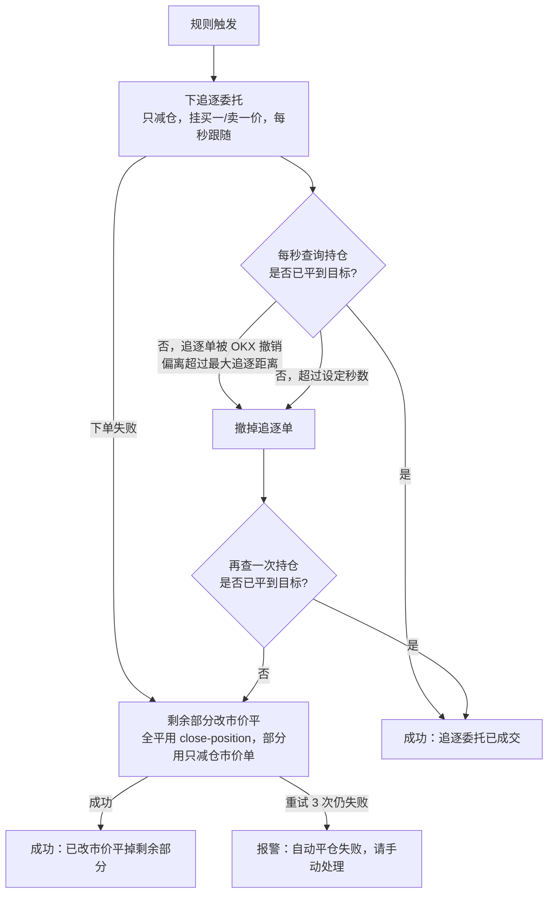

# 仓位哨兵 · 产品文档

> 版本：v0.2.0 · 2026-10-15
> 一句话：一个装在 Mac 上的菜单栏小程序，盯住用户指定的 OKX 永续合约。当「价格在某个位置」并且「N 分钟内涨 / 跌超过 X%」时，自动用追逐委托平仓，追不上就改市价兜底。

---

## 1. 背景与目标

### 1.1 要解决的问题

使用者（下称「用户」）在 OKX 上做永续合约，有一套自己的风控逻辑：**价格到了某个区域后，如果短时间内出现急涨或急跌，就平仓离场**。OKX 原生的止盈止损只能按「价格到某个点」触发，**做不到「N 分钟内涨跌超过 X%」这种按速度触发的条件**。人盯盘又做不到 24 小时。

### 1.2 目标

- 把用户的这套规则交给程序，在用户的 Mac 上 24 小时执行。
- 用户只管设参数；规则怎么算、为什么触发、平了多少，都能在界面上看清楚。
- 安全第一：程序**只能平仓、不能开仓**，也**不能提现**。

### 1.3 不做什么

- 不开仓，不做任何主动交易策略。
- 不替代 OKX 原生止损（见第 9 节「已知限制」）。
- 不做云端部署、不做手机端（v0.2 范围内）。

---

## 2. 角色与分工

| 角色 | 职责 |
|---|---|
| 用户（OKX 账户主人，擅长交易） | 定交易规则和参数；在 OKX 上建 API Key 并亲手填进程序；日常使用 |
| 开发协助者（擅长写代码） | 把程序装到用户的 Mac 上；后续拿源码迭代 |
| Claude | 需求澄清、产品设计、开发、测试、打包 |

用户和开发协助者平时不在一起，**程序要能让用户一个人用**：所有引导、说明、报错提示都内置在程序界面里，不依赖外部文档。

---

## 3. 需求澄清记录

按时间顺序记录每个问题最后怎么定的，后续迭代时可以追溯。

### 3.1 第一轮（v0.1）

| # | 问题 | 结论 | 备注 |
|---|---|---|---|
| 1 | 交易品种 | **U 本位永续合约** | 程序实际监控所有 SWAP 合约 |
| 2 | 电脑系统 | **Mac（苹果芯片）**，macOS Tahoe 26.3 | 打包成 `.app`，Apple 芯片，支持 macOS 11+ |
| 3 | 网络 | **需要开代理才能访问 OKX** | 自动读取 macOS 系统代理；断线 30 秒报警 |
| 4 | 「涨跌幅」的口径 | **币价本身的涨跌幅**，不是含杠杆的持仓收益率 | 价格用 OKX **标记价格** |
| 5 | 「单位时间涨跌幅」怎么算 | 用户给出精确定义（见 4.2）：**当前价对比 N 分钟前锚点价**，锚点取「采样中时间 ≥ 当前 − N 分钟且最近的点」，窗口持续滚动，可以配多个时间窗口 | 推翻了一开始选的「滚动窗口高低点」 |
| 6 | 用哪个价格 | **标记价格** | 不容易被单个交易所插针打穿，误触发更少 |
| 7 | 触发后怎么平 | v0.1：每个币可选「全平 / 平 X% / 只报警」 | v0.2 改为追逐委托，见 3.2 |
| 8 | 开仓前的价格算不算锚点 | **算**，只看币价走势，和开仓时间无关 | |
| 9 | 通知方式 | **Mac 弹窗 + 声音** | 预留了飞书群机器人推送（可选） |
| 10 | 运行环境 | Mac **一直插电放着** | 程序自己防睡眠、开机自启、崩溃自动重启 |
| 11 | 控制面板在哪打开 | **只在这台 Mac 上** | 只监听 127.0.0.1，并校验随机令牌 |
| 12 | 交付方式 | 不要文档，要**能直接运行的 app**，用户一个人用 | 说明全部内置到面板的「帮助」页 |
| 13 | 账户站点 | **中国区**（`www.okx.com`） | |
| 14 | 模拟盘 | 用户**不用模拟盘，直接用小仓位实盘测** | v0.2 已删除模拟盘逻辑 |

### 3.2 第二轮（v0.2）

| # | 问题 | 结论 |
|---|---|---|
| 15 | 平仓方式 | **不用市价单，改用 OKX 追逐委托** |
| 16 | 追逐委托追不上怎么办（急涨急跌时可能一直不成交，或者偏离超过最大追逐距离被 OKX 撤单） | **超时没全部成交、或者被撤单，就撤掉追逐单，把剩余部分改市价平** |
| 17 | 盯哪些标的 | **用户自己选**。只盯添加了的合约，没添加的仓位不管 |
| 18 | 价格条件（新增，**最关键**） | 每个标的**必须先设一个价格**，并选「高于 / 低于」。**只有标记价当下处在那一侧时，规则才生效** |
| 19 | 价格条件是「当下满足」还是「穿过一次后一直有效」 | **当下同时满足**：触发那一刻现价必须在条件内；价格回到另一侧，规则就暂时不生效 |
| 20 | 价格设在哪一层 | **每个标的设一个价格**（含高于 / 低于），这个标的的所有规则共用 |
| 21 | 规则方向怎么表达 | **按价格「涨 / 跌」**，不再用「对仓位不利 / 有利」 |
| 22 | 触发后平哪些仓位 | **平这个标的上的所有仓位**（多单空单都平） |
| 23 | 去掉模拟盘 | **只保留实盘** |

---

## 4. 产品逻辑（v0.2 现行）

### 4.1 盯盘标的

- 用户在「盯盘设置」页手动添加合约，比如 `BTC-USDT-SWAP`。可以从当前持仓里选，也可以手动输入。
- **只有盯盘列表里的标的会被监控和处理。** 不在列表里的仓位显示在监控页的「其他持仓」里，旁边有「盯这个」按钮，但程序不会自动处理它们。
- 每个标的可以单独「启用 / 停用」。
- 每个标的的配置包括：**价格条件（必填）**和**若干条涨跌规则**。

### 4.2 价格采样与锚点（用户给的原始定义）

- 通过 WebSocket 实时接收每个盯盘标的的**标记价格**（行情活跃时大约每 0.2 秒推一次）。
- **每 1 秒采样一次**：把最新标记价连同时间记一个点，存在内存里，保留「最长窗口 + 2 分钟」（至少 17 分钟）。
- 每次计算时：
  - **锚点时刻** = 当前时间 − N 分钟（窗口随时间持续滚动）；
  - **锚点价** = 采样中**时间 ≥ 锚点时刻、且离它最近**的那个点的价格；
  - **涨跌幅** =（当前标记价 − 锚点价）÷ 锚点价。

> 例：现在 12:05:20，规则窗口 3 分钟，锚点时刻就是 12:02:20，基准价取采样里 12:02:20 那个点；那一秒正好缺了，就取 12:02:21 的。

- 计算频率：每收到一次新价格算一次，另外每秒采样时也算一次（价格不动时，锚点仍在往前移）。
- **预热**：刚启动、或刚添加一个标的时，先用 OKX 过去的 1 分钟标记价 K 线收盘价把历史补满，保护马上生效。补数据完成前，数据不满一个窗口，就从最早的数据点算起，界面上会提示「数据还不满一个窗口」。

### 4.3 价格条件

- 每个标的设一个价格 P，并选方向：
  - **高于**：标记价 ≥ P 时满足；
  - **低于**：标记价 ≤ P 时满足。
- **判断的是触发那一刻的现价**：满足时这个标的的规则才生效；价格回到另一侧，规则就暂时不生效（规则本身照常计算并显示，只是不会执行）。
- 价格条件**必填**，没设价格就不能保存。

### 4.4 涨跌规则

每条规则包含：

| 字段 | 含义 |
|---|---|
| 时间窗口 N | 和多久前比，单位分钟，可以带小数（最小 2 秒，最大 360 分钟） |
| 方向 | **涨**：涨跌幅 ≥ +X%；**跌**：涨跌幅 ≤ −X% |
| 幅度 X | 百分比，大于 0、小于 100 |
| 动作 | **全平** / **按比例平仓**（1%–99%）/ **只报警** |
| 启用 | 可以临时关掉单条规则 |

一个标的可以配任意多条规则，比如同时配「5 分钟跌 2%」和「15 分钟跌 4%」。

### 4.5 触发判定

一条规则触发，需要以下条件**同时成立**：

1. 标的已启用，规则已启用；
2. **价格条件当下满足**；
3. 涨跌幅达到规则的幅度；
4. 这条规则不在冷却期；
5. 最新标记价不超过 30 秒（行情没有中断）；
6. 程序没有暂停、Key 有效、连接就绪；
7. 这个标的上没有正在进行的平仓；
8. 动作是平仓时，这个标的上要有持仓（没持仓就什么都不做）；「只报警」不要求有持仓，可以当价格提醒用。

**同时有多条规则触发**：只执行最重的那个动作，轻重顺序是 **全平 > 按比例平仓 > 只报警**（都是按比例时，取比例大的）。所有同时触发的规则都进入冷却。

**冷却**：一条规则触发后，在这个标的上冷却 **N 分钟**（就是它自己的窗口长度）。避免「平 50%」刚平完，下一秒涨跌幅还在阈值外，又把剩下的也平了；「只报警」也不会每秒响一次。冷却期间其他规则照常工作。

### 4.6 平仓执行：追逐委托 + 市价兜底

**平哪些仓位**：触发后平这个标的上的**所有仓位**（开平仓模式下多单和空单都平；买卖模式下只有一个净仓位）。每个仓位并行处理。

**平多少**：

- 全平：整个仓位。
- 按比例：仓位张数 × 比例，按合约最小变动单位（lotSz）向下取整；如果取整后不够最小下单张数（minSz），或者平完后剩下的不够最小张数，就**改为全平**。

**怎么平**：



| 参数 | 默认 | 在哪改 |
|---|---|---|
| 追逐超时：多少秒没全部成交就改市价 | 30 秒（可设 3–600） | 设置 → 平仓方式 |
| 最大追逐距离：价格偏离首次挂单价超过这个比例，OKX 撤单 | 1%（可设 0.05%–20%） | 设置 → 平仓方式 |

- 追逐委托不设偏移，直接挂在最优价（买一 / 卖一）；方向是平仓方向（多单卖出、空单买入）；买卖模式下加「只减仓」，开平仓模式下指定持仓方向。
- 判断是否成交**以持仓张数为准**，不依赖委托单状态，避免因为状态延迟而重复平仓。
- 市价兜底遇到网络超时，重试前先查一次持仓，确认上一次没有成交才重发，避免多平。
- OKX 返回「仓位不存在」时视为已经平掉。

### 4.7 结果反馈

- 成功：提示音 + 弹窗（写明价格条件、锚点时刻和锚点价、现价、涨跌幅、触发的规则、每个仓位是追逐成交还是市价兜底），同时写入「记录」。
- 失败：**循环响铃 + 弹窗**，提示「立刻去 OKX 手动处理」，直到用户点「知道了」。
- 「只报警」规则触发：循环响铃 + 弹窗，不动仓位。

---

## 5. 保护与报警

| 情况 | 程序行为 |
|---|---|
| 与 OKX 断线超过 30 秒（行情或账户连接） | 循环响铃 + 弹窗，菜单栏图标变红；断线期间不做任何判断；恢复后发通知 |
| 某个标的超过 30 秒没收到标记价 | 暂停对这个标的的判断并报警，避免拿旧价格误平 |
| 查询持仓连续失败超过 60 秒 | 报警 |
| API Key 失效 / 被删除 / 填错 | 程序进入「已停止工作」状态并报警，提示重新填 Key（失败原因翻译成中文，比如「14 天未使用被 OKX 自动删除」） |
| Key 带「提现」权限 | **拒绝使用**，要求删掉重建 |
| Key 没有「交易」权限 | 拒绝使用 |
| 电脑时间偏差 | 自动和 OKX 服务器时间校正，每 10 分钟同步一次 |
| WebSocket 断开 | 自动重连（指数退避，最长 15 秒），重连后恢复订阅 |
| 仓位没挂 OKX 原生止损 | 监控页标红提醒，不影响运行 |

**响铃与确认**：严重报警会循环响铃（最长 30 分钟）。点弹窗的「知道了」、面板的「停止响铃」、或者菜单栏的「停止响铃」都能停下。断线这类持续性的问题，确认后响铃会停，但报警会一直显示到问题恢复。

---

## 6. 安全设计

1. **代码里没有开仓**：会改变账户的接口只有追逐委托（只减仓 / 平仓方向）、撤销追逐委托、市价全平、只减仓市价单。
2. **API Key 权限最小化**：只要「读取 + 交易」；启动时读取 Key 的实际权限，**发现带提现权限就拒绝运行**。即使 Key 泄露，钱也转不走。
3. **Key 只在用户的 Mac 上**：由用户本人在面板里填写，存进 macOS 钥匙串；日志和记录里都不会写 Key。开发协助者和 Claude 都不经手实盘 Key。
4. **控制面板只有本机能访问**：只监听 127.0.0.1；接口要带每次启动随机生成的令牌，并校验 Host 头，防止网页或局域网里的其他设备调用。
5. **IP 白名单**：因为通过代理上网、出口 IP 会变，Key **不绑 IP**。代价是 OKX 规定：没绑 IP、带交易权限的 Key，连续 14 天没被使用会被自动删除。程序运行时一直在调用，所以不会被删。

---

## 7. 界面

### 7.1 菜单栏图标

| 图标 | 含义 |
|---|---|
| 🟢 | 正常监控 |
| 🟡 | 已暂停（只看不动） |
| 🔴 | 断线 / 行情中断 / Key 失效 / 平仓失败 |
| ⚪ | 还没填 API Key |
| ⏳ | 正在连接 |

点开图标的菜单：当前状态、盯盘标的列表、打开控制面板、暂停 / 恢复自动平仓、停止响铃、退出（退出前会二次确认）。

### 7.2 控制面板（浏览器打开，只有本机能访问）

| 页面 | 内容 |
|---|---|
| 监控 | 首次使用引导（建 Key 的步骤 + 填写表单）；自检结果；每个盯盘标的一张卡片：标记价、价格条件当前是否满足、持仓（是否挂了原生止损）、每条规则的实时计算（锚点时刻和锚点价 → 现在的涨跌幅，离触发还差多少，冷却状态）；「其他持仓」（不在盯盘列表里的仓位） |
| 盯盘设置 | 添加 / 删除标的；设价格条件（高于 / 低于 + 价格，必填）；编辑规则；每条规则下面用一句话解释它会做什么；保存前弹窗确认全部规则 |
| 记录 | 最近 200 条：触发、平仓、报警、系统事件、设置改动；可以筛选 |
| 设置 | API Key（更换 / 删除）；平仓方式（追逐超时秒数、最大追逐距离）；网络代理（自动 / 手动 / 不用）；测试报警；飞书推送（可选）；开机自启；打开日志文件夹 |
| 帮助 | 规则怎么算、怎么建 API Key、图标含义、报警怎么处理、它做不到的事、电脑要保持什么状态 |

顶部常驻：状态、「停止响铃」（响铃时出现）、「暂停自动平仓」。

---

## 8. 运行环境与部署

- **形态**：`PositionGuard.app`，用 PyInstaller 打包，Apple 芯片，支持 macOS 11+，大约 27 MB。用户电脑上不需要装 Python。
- **安装**：把 zip 用 AirDrop 或 U 盘拷过去，解压后拖进「应用程序」。应用没有 Apple 开发者签名，所以需要在终端执行一次：
  ```bash
  xattr -cr /Applications/PositionGuard.app
  ```
  否则 macOS 会提示「已损坏」。
- **开机自启**：写入 `~/Library/LaunchAgents/com.positionguard.agent.plist`。登录后自动启动；程序异常退出时由系统自动拉起；用户主动点「退出」则不会拉起。
- **防睡眠**：程序运行期间用 `caffeinate` 阻止系统睡眠（接电源时）。笔记本合盖仍然会睡眠。
- **代理**：默认读取 macOS 系统代理；也可以手动填，或者不用代理（TUN 模式）。
- **数据目录**：`~/Library/Application Support/PositionGuard/`，里面有配置 `config.json`、事件记录 `events.jsonl`、运行日志 `app.log`。
- **单实例**：重复打开不会起第二个进程，只会打开已运行实例的面板。

### 8.1 用到的 OKX 接口

| 用途 | 接口 |
|---|---|
| 服务器时间 | `GET /api/v5/public/time` |
| 合约信息（最小张数等） | `GET /api/v5/public/instruments` |
| 历史标记价 K 线（预热） | `GET /api/v5/market/mark-price-candles` |
| 账户配置（权限、持仓模式） | `GET /api/v5/account/config` |
| 持仓 | `GET /api/v5/account/positions` + WS `positions` 频道 |
| 已挂的止损单（原生止损检测） | `GET /api/v5/trade/orders-algo-pending` |
| 实时标记价 | WS 公共频道 `mark-price` |
| 追逐委托 | `POST /api/v5/trade/order-algo`（ordType=chase） |
| 查询 / 撤销追逐委托 | `GET /api/v5/trade/order-algo`、`POST /api/v5/trade/cancel-algos` |
| 市价全平（兜底） | `POST /api/v5/trade/close-position` |
| 只减仓市价单（部分平仓兜底） | `POST /api/v5/trade/order` |

REST 域名用 `www.okx.com`，连不上时自动切到 `openapi.okx.com`；WebSocket 用 `ws.okx.com`。

---

## 9. 已知限制与风险

1. **电脑离线就没有保护**：关机、断电、睡眠、退出登录、代理断开、OKX 接口故障时，程序都不工作。**每个仓位仍然要在 OKX 上挂原生止损**作为第一道防线，本程序是第二道。
2. **追逐委托在急涨急跌时可能追不上**：它只挂单、不主动吃单，价格跑得快时会一直挂不上去，最后靠市价兜底。兜底之前最多等「追逐超时」设定的秒数（默认 30 秒）。在这类行情下，30 秒可能已经很长了，用户应该根据自己的风险偏好调整。
3. **市价兜底有滑点**：行情剧烈时，成交价可能明显偏离触发时的价格。
4. **标记价 ≠ 最新成交价**：触发时盘口的成交价，可能和用户在 K 线上看到的不完全一样。
5. **人不在电脑旁时收不到报警**：目前只有 Mac 弹窗和声音；飞书推送已经预留，填地址就能用，但默认没开。
6. **没有 Apple 签名**：每次更新版本都要执行一次 `xattr -cr`；而且新版本的签名变了，第一次读取钥匙串时，macOS 会弹窗要求输入电脑密码并点「始终允许」。

---

## 10. 版本记录

### v0.2.0（2026-10-15）

- 新增：**盯盘列表**，只处理用户添加的标的。
- 新增：**价格条件**（每个标的「高于 / 低于 某价格」，必填，触发那一刻必须满足）。
- 修改：规则方向从「不利 / 有利」改为按价格「涨 / 跌」。
- 修改：触发后平这个标的上的**所有仓位**（多空都平）。
- 修改：平仓从市价单改为**追逐委托**，超时或被撤单就把剩余部分改市价兜底；超时秒数和最大追逐距离可以配置。
- 修改：「只报警」规则没有持仓时也会响，可以当价格提醒用。
- 删除：模拟盘。
- 不兼容：v0.1 的规则格式不再读取，升级后要在「盯盘设置」里重新配置。已经保存的 API Key 继续可用。

### v0.1.0（2026-10-15）

- 首个可运行版本：自动监控所有永续仓位；按「不利 / 有利」方向配置规则；市价平仓；模拟盘 / 实盘切换。

---

## 11. 还没搞清楚的问题

1. **追逐委托的参数格式还没在实盘上验证**：现在只设了「最大追逐距离（比例）」，偏移用默认值（挂在最优价）。如果 OKX 拒绝这个参数组合，程序会立即改市价兜底，并在记录里写明原因。所以第一次实盘触发时，要看一眼记录：是「追逐委托已成交」，还是「追逐委托下单失败」。
2. **追逐超时设多少合适**：默认 30 秒是个占位值。这其实是用户的交易判断：急跌时多等 30 秒，可能比市价单的滑点损失更大。
3. **要不要「穿过一次就一直有效」的价格条件**：目前按「当下满足」实现（问题 19）。如果用户实际使用后觉得规则在价格条件边界附近反复失效，再考虑加这种模式。
4. **离线保护的缺口**：电脑离线时完全没有保护，这个缺口只能靠原生止损补。如果以后需要 24 小时可靠运行，下一步是部署到海外云服务器（不需要代理，还能绑固定 IP）。
